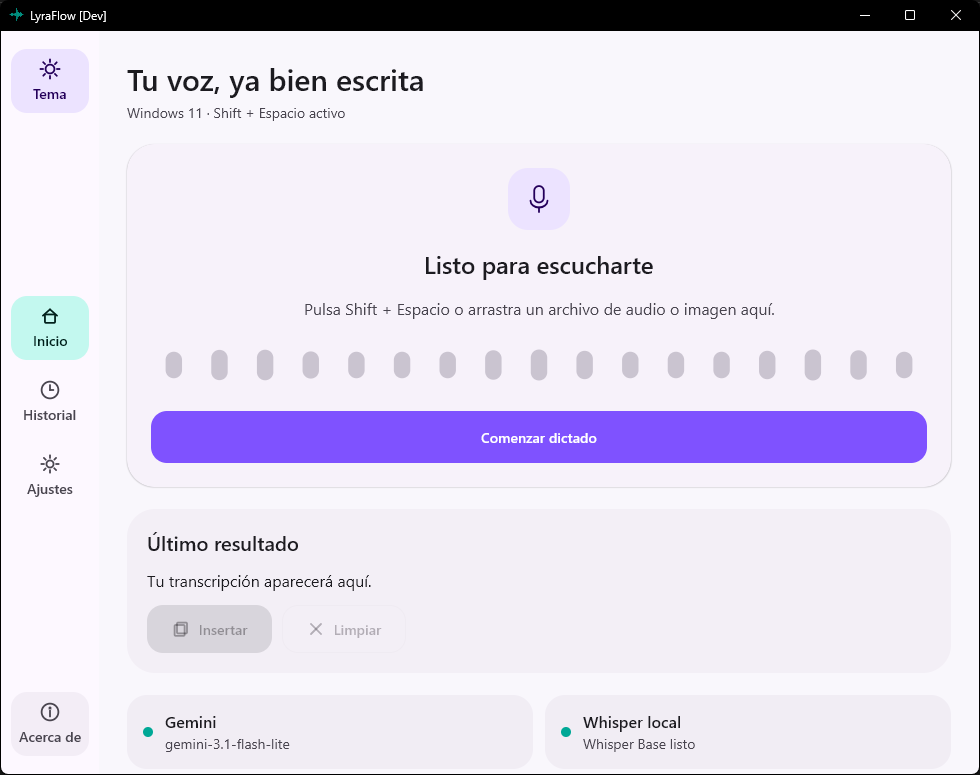
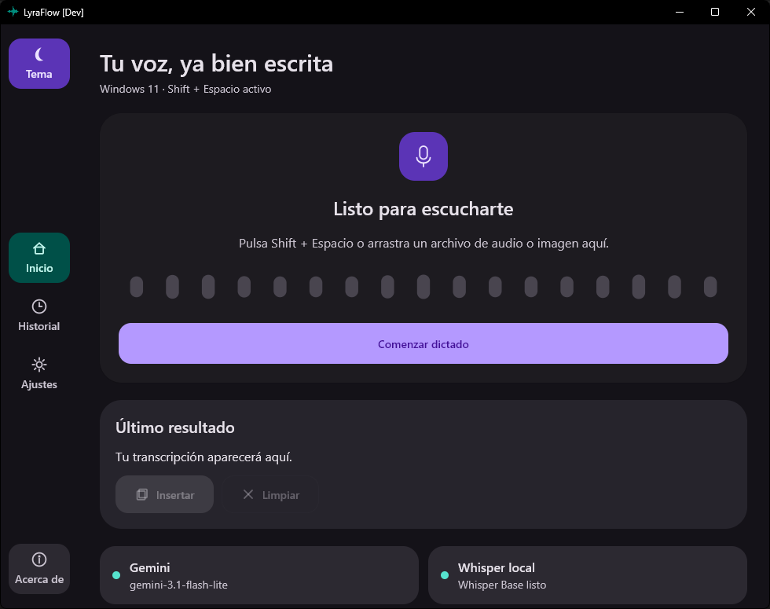
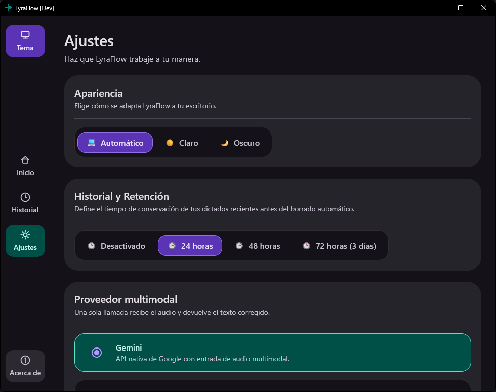
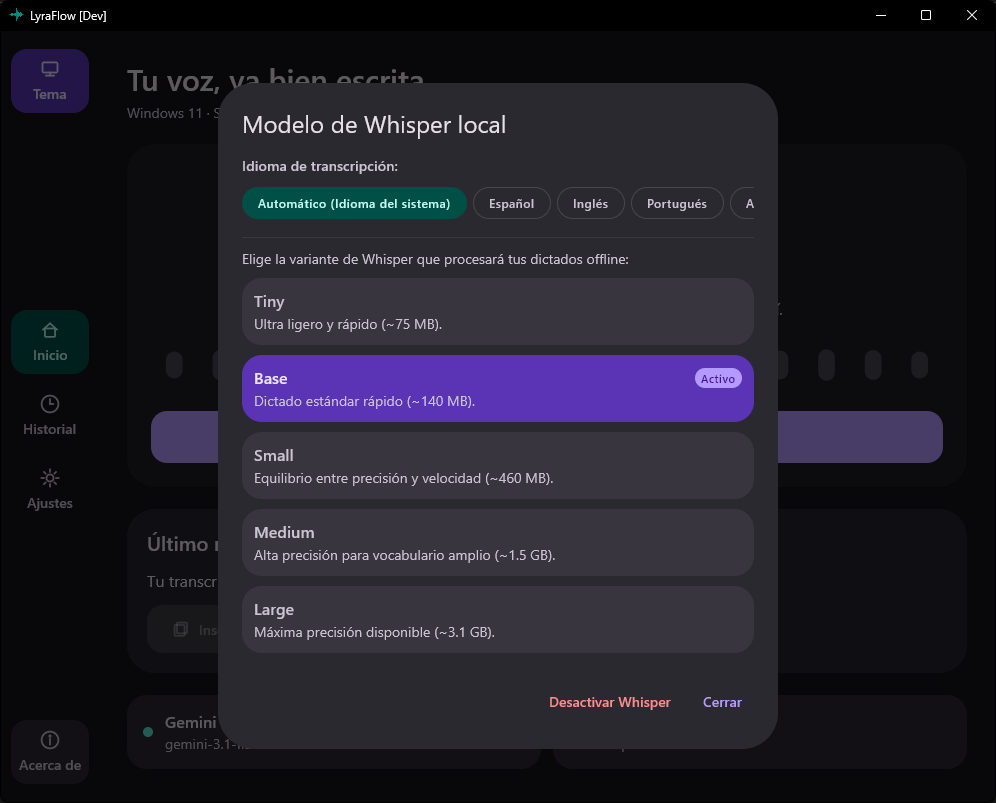

# LyraFlow 🎙️✨

[](https://github.com/biglexj/LyraFlow/releases/latest)
[](LICENSE)
[](https://github.com/biglexj/LyraFlow)

LyraFlow es una aplicación de dictado inteligente construida con Kotlin Multiplatform y Compose Multiplatform. Captura tu voz mediante un atajo global, la convierte en texto contextualizado y la inserta en la aplicación activa.

**Rama activa de desarrollo Rust + GPUI (`codex/rust-gpui-demo`):** `mise dev` abre la edición nativa desde `native/`. [Alcance, requisitos y comandos](native/README.md). La edición Compose en producción (`v1.1.9`) vive en `main` y `preview`.

## 📸 Capturas de Pantalla

| Inicio claro | Inicio oscuro |
| :---: | :---: |
|  |  |

| Ajustes | Modelo Whisper local |
| :---: | :---: |
|  |  |

## Organización de recursos

El icono canónico de identidad se conserva en [`assets/branding/icons/icon-transparent.png`](assets/branding/icons/icon-transparent.png). Los recursos derivados deben generarse desde esa fuente conforme al [Asset Organization Standard](../Docs/global/architecture/asset-organization-standard.md); las capturas documentales viven en `Docs/screenshots/`.


## Funciones actuales

- Atajo global `Ctrl + Espacio` en Windows, personalizable con combinaciones de 2 o 3 teclas.
- Captura WAV mono a 16 kHz con nivel y duración visibles.
- Transcripción y corrección contextual mediante Gemini, MiniMax o cualquier API OpenAI-compatible cuyo modelo acepte audio.
- Atajo global independiente (`Ctrl + Alt + Espacio` por defecto) para cancelar un dictado en curso sin transcribirlo.
- Comprobación automática de actualizaciones desde GitHub Releases con sanitización del body y toast flotante global.
- Modal e insignia "Acerca de la Aplicación" con opciones de apoyo oficial y donación directa.
- Compatibilidad prevista con Whisper local mediante sidecar.
- Inserción directa usando portapapeles y simulación de teclado.
- Temas automático, claro y oscuro con Material 3 Expressive.
- Preferencias persistentes para tema, modelo, atajos e inyección automática.
- Escritorio Windows/Linux y base compartida para Android.

## Tecnologías

- Kotlin Multiplatform 2.3.10.
- Compose Multiplatform 1.11.1.
- Gradle 9.4.1.
- Ktor para APIs multimodales nativas y OpenAI-compatible.
- JNA para integraciones de escritorio.

## Ejecutar en escritorio

Requiere JDK 17 o posterior. El proyecto está verificado con Temurin 25.

```powershell
mise dev
```

Mise es la entrada principal; Gradle sigue siendo el motor de compilación.

Desde Ajustes puedes seleccionar Gemini o `OpenAI / compatible`, escribir el identificador del modelo y configurar el endpoint completo. La clave puede definirse mediante `LYRAFLOW_API_KEY`, `GEMINI_API_KEY` u `OPENAI_API_KEY`, o introducirse desde Ajustes. En Windows se conserva cifrada con DPAPI por proveedor; borrar el campo elimina también la copia persistida.

El adaptador compatible envía audio y la instrucción en una sola solicitud Chat Completions usando `input_audio`. Esto permite conectar OpenAI, gateways, Qwen, servidores vLLM/SGLang y otros servicios con ese contrato. La compatibilidad del protocolo no garantiza que todos los modelos acepten audio: el modelo y la ruta elegidos deben soportarlo.

`MiniMax` usa su transcriptor dedicado: el audio entra por `POST /speech_to_text` (modelo `asr-1.0`) y el texto resultante se refina después con `MiniMax-M3.1-Flash` mediante `/chat/completions`. No es el mismo camino que el adaptador OpenAI-compatible porque MiniMax no acepta audio en Chat Completions. El endpoint que LyraFlow guarda es la URL base (`https://api.minimax.io/v1`) y la clave se lee de `MINIMAX_API_KEY`. MiniMax limita cada audio a 500 segundos y 50 MB.

Los dos atajos globales por defecto son `Ctrl + Espacio` para alternar grabar/detener y `Ctrl + Alt + Espacio` para cancelar el dictado en curso. Ambos se editan en Ajustes y no pueden coincidir entre sí; si coinciden, LyraFlow vuelve al valor por defecto.

La tarjeta `Whisper local` instala bajo demanda el binario x64 desde la última release oficial de `ggml-org/whisper.cpp` y el modelo base en los datos locales del usuario. La interfaz muestra el progreso y permite reintentar si la descarga falla.

## Verificación

```powershell
$env:ANDROID_HOME = Join-Path $env:LOCALAPPDATA "Android\Sdk"
mise check
```

`check` compila el escritorio y Android; `test` ejecuta la suite de escritorio (`desktopTest`).

## Operación con Mise (Estándar Ecosistema)

LyraFlow implementa la interfaz universal de tareas mediante Mise:

| Tarea | Propósito |
|---|---|
| `mise dev` | Ejecutar en modo desarrollo (`gradlew dev`). |
| `mise dev isolated` | Ejecutar otra instancia de desarrollo. |
| `mise check` | Verificar compilación de escritorio y Android. |
| `mise check desktop` | Verificar solo el escritorio. |
| `mise test` | Ejecutar pruebas de escritorio. |
| `mise test scripts` | Verificar las herramientas de tareas y empaquetado. |
| `mise build` | Compilar ejecutable de escritorio (`gradlew buildDesktop`) sin generar instaladores. |
| `mise release` | Generar instalador oficial Inno Setup en `release/` sin publicar. |
| `mise publish` | Publicar en GitHub Releases y sincronizar ficha en Aurora (`--plan` y `--check` sin escritura). |

Opciones de inspección y comprobación:
- `--plan`: Muestra el comando y las operaciones planificadas sin ejecutar procesos ni modificar el sistema (`mise dev --plan`, `mise release --plan`, `mise publish --plan`).
- `--check`: (para `publish`) Verifica el estado del repositorio, tags, notas y la presencia e integridad del instalador en `release/` sin publicar nada (`mise publish --check`).
- Canal explícito `github`: `mise publish github` (omite la sincronización con la web de Aurora).

## Alias de comandos

Siguen el [estándar global de scripts y alias de comandos](https://github.com/biglexj/Docs) (sección E, Kotlin Multiplatform). No hace falta memorizar ni `:composeApp:run` ni la ruta de `scripts/`.

| Alias | Equivalente | Qué hace |
|---|---|---|
| `.\gradlew.bat dev` | `npm run dev` | Ejecuta la app de escritorio en modo desarrollo. |
| `.\gradlew.bat devIsolated` | `npm run dev:isolated` | Igual que `dev`, pero permite varias instancias simultáneas. |
| `.\gradlew.bat devAndroid` | `npm run dev:android` | Compila e instala en el dispositivo Android conectado. |
| `.\gradlew.bat test` | `npm test` | Ejecuta las pruebas de escritorio. |
| `.\gradlew.bat check` | `npm run check` | Compila escritorio y Android. |
| `.\gradlew.bat build` | `npm run build` | Genera la imagen de aplicación lista para ejecutar. |
| `.\gradlew.bat buildDesktop` | `npm run build:desktop` | Igual, pero solo escritorio (sin Android ni pruebas). |
| `.\gradlew.bat releaseLocal` | `npm run release:local` | Compila, empaqueta y firma el instalador EXE sin publicar. |
| `.\gradlew.bat releasePublish` | `npm run release:publish` | Release oficial: tag, push, GitHub y Aurora. |

Los alias de Gradle y package.json delegan en las tareas y scripts canónicos, sin lanzadores adicionales en la raíz.

## Distribución

LyraFlow se distribuye en Windows mediante un único instalador ejecutable: `LyraFlow-Windows-X.Y.Z.exe` (en esta versión, `LyraFlow-Windows-1.1.9.exe`). La versión está centralizada en `gradle.properties` (`lyraflow.versionName`) y se propaga al instalador, a «Acerca de la aplicación», a Ajustes y a las notas de la release.

```powershell
mise release
```

Genera y valida el instalador EXE firmado y su `SHA256SUMS.txt` en `release/`, sin modificar Git ni GitHub. Para publicar la versión activa desde `preview` o `main`, con el árbol revisado y limpio:

```powershell
mise publish
```

El flujo verifica el código revisado, genera el instalador, crea un tag nuevo, realiza un push atómico y verifica la descarga pública antes de sincronizar la ficha de Aurora. No crea commits ni incorpora cambios sin revisar.

El instalador se compila con Inno Setup a partir de la plantilla propia de Biglex: instalación por usuario, sin elevación, actualización en el mismo directorio y una única pantalla de entrada con la identidad visual de LyraFlow. La migración del MSI anterior conserva su carpeta y retira ese instalador; está documentada en [`packaging/windows/MIGRATION.md`](packaging/windows/MIGRATION.md).

## Estado de plataforma

- Windows: hotkey, audio, Gemini, OpenAI-compatible, Whisper local e inyección disponibles.
- Linux: paquetes configurados; hotkey e inyección nativos aún en desarrollo.
- Android: interfaz compartida compilable; captura y permisos aún pendientes.

Licencia MIT · Biglex J, 2026.
